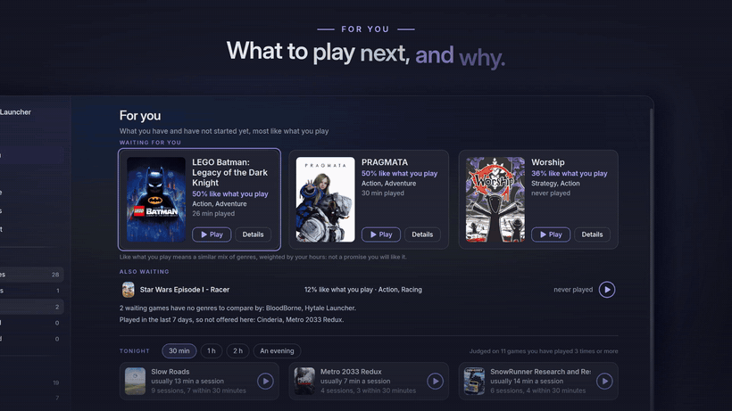
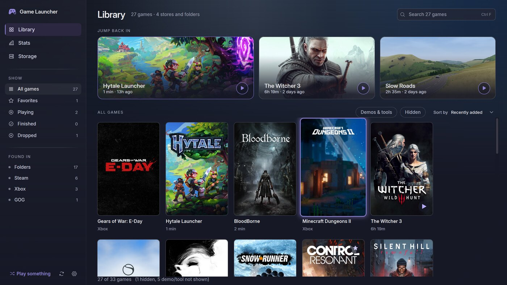
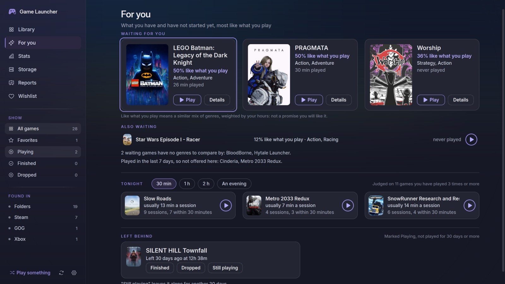
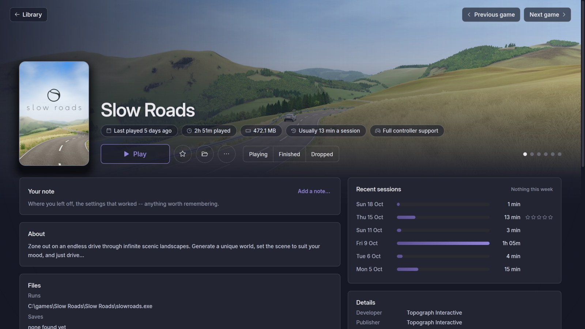
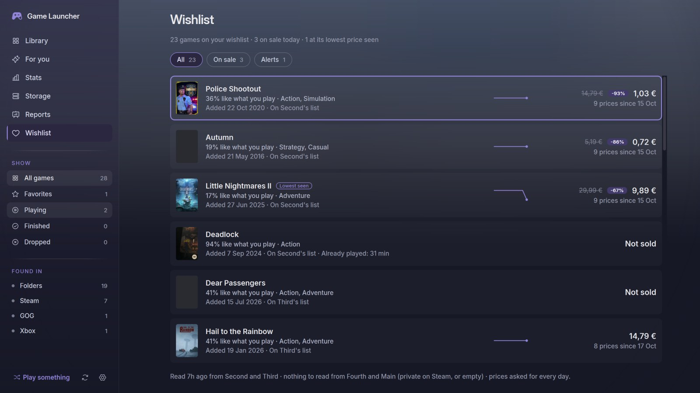
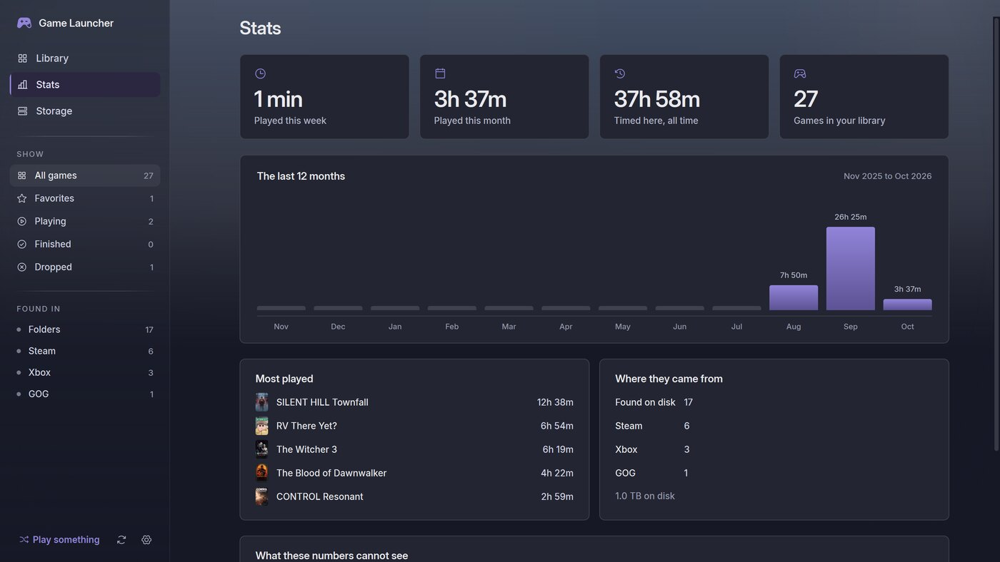
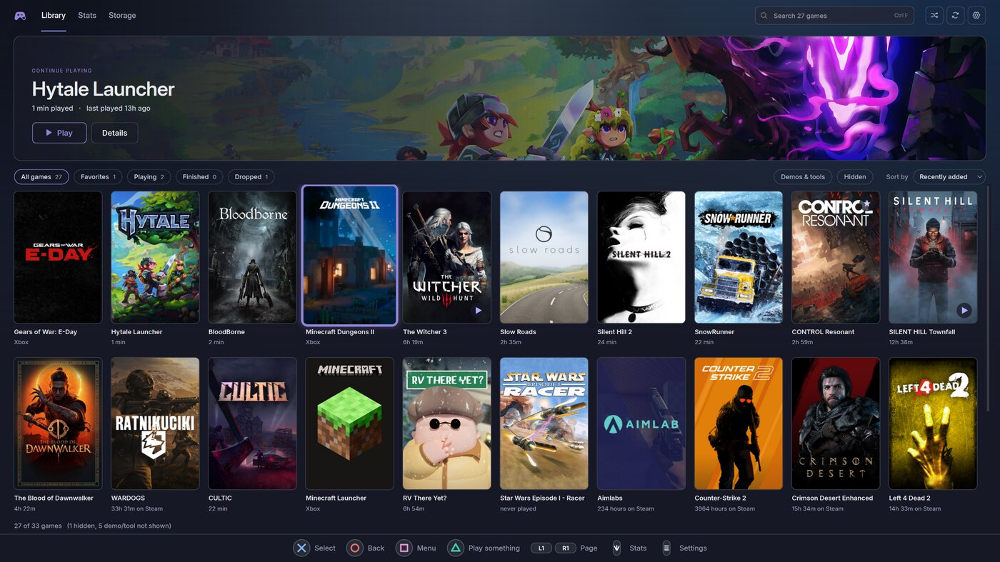
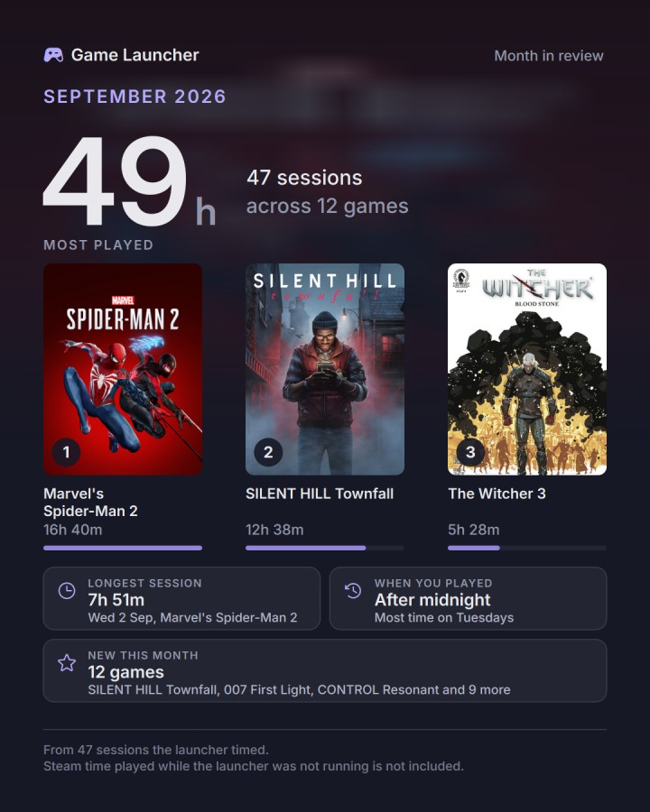

# Game Launcher

Toate jocurile de pe PC într-un singur loc: Steam, GOG, Epic, Xbox și cele din folderele tale.
Un launcher pentru Windows, făcut ca lucrare de licență și dat câtorva prieteni.

  
   
  ▶ <a href="https://raw.githubusercontent.com/GreenYRO/game-launcher-releases/main/docs/media/game-launcher-trailer.mp4">Descarcă trailerul întreg, cu sunet</a> (37 de secunde, 9,4 MB)

**[English below ↓](#english)**

## Descarcă și instalează

1. Descarcă **[GameLauncher-Setup.exe](https://github.com/GreenYRO/game-launcher-releases/releases/latest/download/GameLauncher-Setup.exe)**
   (aprox. 70 MB). Linkul duce mereu la ultima versiune; lista completă e la
   [Releases](https://github.com/GreenYRO/game-launcher-releases/releases). Merge pe Windows 11 sau 10, pe 64 de biți.
2. Rulează-l. Nu cere parolă de administrator și pune scurtături pe Desktop și în meniul Start.
3. **Windows o să te avertizeze**: „Windows a protejat PC-ul” (*Windows protected your PC*). Apasă pe
   **Mai multe informații** (*More info*), apoi pe **Rulează oricum** (*Run anyway*). Avertismentul apare
   pentru că fișierul nu e semnat digital de o firmă (o astfel de semnătură costă bani în fiecare an), nu
   pentru că programul ar avea ceva. Rulează-l doar dacă l-ai luat de pe pagina asta sau direct de la mine.
4. La prima pornire te întreabă unde îți ții jocurile și, opțional, o cheie SteamGridDB pentru mai multe
   coperți. Poți sări peste a doua întrebare.

<!-- docs/media/smartscreen.png: captura cu „Mai multe informații” / „Rulează oricum”

  

-->

## Ce face

- Găsește jocurile instalate din **Steam, GOG, Epic și Xbox** și pe cele pe care le-ai pus singur
  într-un folder (copiate, dezarhivate sau instalate cu installer-ul lor).
- Le arată ca o **grilă de coperți**, pe care o filtrezi și după gen. Fiecare joc are pagina lui: descriere,
  capturi, știri, prețul din Steam și sesiunile tale.
- **For you** (sub Library) îți arată ce ai instalat și n-ai început, în ordinea asemănării cu ce joci, și ce
  încape diseară: o jumătate de oră, o oră, două sau o seară.
- Le **pornește** (cât se deschide jocul scrie **Starting…**) și ține minte **cât ai jucat**. Notează și
  sesiunile jocurilor pornite din altă parte (din Steam, din scurtătura lor), cât rulează launcher-ul; pentru
  jocurile din Steam arată și timpul pe care îl ține Steam.
- După o sesiune te întreabă **How was it?**: o stea apăsată o notează, **Skip** trece mai departe.
- **Stats** și cardul **Recap**: luna sau anul tău ca o imagine pe care o trimiți prietenilor.
- **Wishlist**: lista ta de dorințe Steam cu prețurile zilei. Te anunță o dată când un joc ajunge la cel mai
  mic preț văzut vreodată sau sub suma pe care i-ai pus-o.
- Face **copii ale salvărilor** jocurilor pornite din el.
- Merge cu **controlerul** (Xbox, DualSense) și pe **televizor**, în modul TV; culoarea o alegi dintre cinci.
- Poate sta ca iconiță lângă ceas și porni odată cu Windows (dacă vrei). Pagina **Reports** are unsprezece
  rapoarte despre biblioteca ta, calculate pe PC-ul tău.

| Biblioteca | For you |
|:---:|:---:|
|  |  |
| **Pagina unui joc** | **Wishlist** |
|  |  |
| **Statistici** | **Modul TV** |
|  |  |

  
   
  Cardul <b>Recap</b>: Stats → <b>Share as image...</b> copiază sau salvează imaginea; nu are căi de foldere, conturi sau e-mail.

## Ce citește de pe PC-ul tău

- **Folderele cu jocuri pe care le alegi tu.** Le schimbi oricând din Settings → Finding games → Game folders.
- **Ce au instalat Steam, GOG, Epic și Xbox**, din fișierele lor de pe PC.
- **Timpul jucat pe care Steam îl ține singur**, pentru fiecare cont care a intrat pe PC. Tu alegi în
  Settings care conturi sunt ale tale.
- **Numele și datele fișierelor din folderele de salvări** (Documente, AppData), ca să afle unde își ține
  salvările un joc pornit din launcher. Nu le deschide și nu le citește conținutul.
- **Ce programe rulează**, doar ca să-și dea seama când e pornit un joc de-al tău din altă parte; nu se uită
  la altceva și nu ține altceva. Se oprește din Settings → Running in the background.

## Ce nu face niciodată

- **Nu are cont și nu cere niciun login.**
- **Nu trimite nimic despre tine nicăieri.** Tot ce știe rămâne pe PC-ul tău.
- De pe internet cere doar **pagini publice ale magazinului Steam** (coperți, descrieri, prețuri, știri)
  și, o dată pe zi, întreabă **GitHub** dacă a apărut o versiune nouă a launcher-ului. Nu trimite nume, cont
  sau altceva despre tine. Poți opri tot: Settings → „Allow network lookups”.
- **Lista de dorințe Steam:** pentru conturile marcate „Mine”, întreabă Steam o dată pe zi ce e pe lista ta
  publică (după numărul contului, singurul lucru despre tine care pleacă, și doar spre Steam) și îi urmărește
  prețurile pe pagina **Wishlist**. Nu o schimbă niciodată și nu intră în cont; o listă privată nu apare.
- **SteamGridDB** (mai multe coperți) se folosește doar dacă îți pui singur o cheie gratuită a ta: pe
  steamgriddb.com intri cu contul Steam, Preferences → API, generezi cheia și o lipești la prima pornire sau
  oricând în Settings → Artwork and the internet. Acolo, **Fill missing covers...** caută dintr-o dată
  coperți pentru jocurile fără una.

## Actualizare

Launcher-ul îți spune singur când a apărut o versiune nouă: un mesaj la pornire și, în Settings → About →
Updates, **See what's new** (ce aduce) și **Open the download page**. Nu descarcă și nu instalează nimic
singur. Închizi launcher-ul (dacă stă lângă ceas: clic dreapta → Quit) și rulezi noul `GameLauncher-Setup.exe`
peste cel vechi. Păstrează tot: jocurile, timpul jucat, coperțile alese și setările. La prima pornire după
actualizare îți arată o dată ce e nou.

## Să rămână pornit în fundal

În Settings → **Running in the background** sunt trei comutatoare:

- **Keep running when the window is closed**: oprit la început, dar te întreabă o dată dacă îl vrei pornit.
  Închizi fereastra și launcher-ul rămâne ca iconiță lângă ceas; clic: fereastra; clic dreapta: jocuri,
  Settings..., **Quit**.
- **Start with Windows** (oprit): pornește ascuns, doar cu iconița, când intri în Windows.
- **Notice games started outside the launcher** (pornit): notează sesiunile unui joc de-al tău oricum l-ai
  pornit, cât rulează launcher-ul.

## Dacă ceva nu merge

Settings → Your library data → **Save diagnostics...** face un zip pe care mi-l trimiți. Conține jurnalul
programului, versiunea, setările (fără cheia SteamGridDB) și ce a găsit ultima căutare de jocuri, cu căile
folderelor, ca să-mi dau seama de ce nu găsește un joc. **Nu conține** timpul jucat, notițele, ce ai plătit
pe jocuri sau conturile tale Steam.

## Unde îi stau datele

Într-un singur folder: **`%LOCALAPPDATA%\Programs\Game Launcher`** (scrie asta în bara de adrese din File
Explorer). Acolo sunt setările, biblioteca, copiile de siguranță și copiile salvărilor. Copiezi folderul și
ai o copie de rezervă.

## Pentru lucrarea mea de licență

Launcher-ul este lucrarea mea de licență. S-ar putea să te rog să-mi trimiți un **export anonim** al
bibliotecii tale: ce jocuri ai, cât le-ai jucat și ce note le-ai dat, fără căi de foldere și fără nume de
conturi, ca să pot compara mai multe biblioteci în lucrare. **E alegerea ta.** Dacă nu vrei, nu se trimite
nimic, iar launcher-ul merge exact la fel.

Dacă vrei: Settings → Your library data → **Anonymous export...**. Fereastra îți arată dinainte ce conține,
cu numerele bibliotecii tale; salvezi un fișier pe care îl poți deschide în Notepad și citi tot. Din
launcher nu pleacă nimic singur: fișierul mi-l trimiți tu. Ce ai plătit pe jocuri intră doar dacă bifezi
asta; conturile Steam apar ca „A”, „B”, fără nume sau numere.

## Dezinstalare

Setări Windows → Aplicații → Game Launcher → Dezinstalare. Te întreabă dacă vrei să păstrezi setările și
timpul jucat, ca să le regăsești dacă îl instalezi din nou.

## Codul

Codul nu e în acest depozit; aici sunt doar installerele.

---

## English

All the games on your PC in one place: Steam, GOG, Epic, Xbox and the ones in your own folders.
A Windows game launcher made for a bachelor thesis and shared with a few friends.

The trailer is at the top of the page: [download it with sound](https://raw.githubusercontent.com/GreenYRO/game-launcher-releases/main/docs/media/game-launcher-trailer.mp4) (37 seconds, 9.4 MB).

### Download and install

1. Download **[GameLauncher-Setup.exe](https://github.com/GreenYRO/game-launcher-releases/releases/latest/download/GameLauncher-Setup.exe)**
   (about 70 MB). The link always points at the newest version; every version is listed under
   [Releases](https://github.com/GreenYRO/game-launcher-releases/releases). Windows 11 or 10, 64-bit.
2. Run it. It needs no administrator password and adds shortcuts to the Desktop and the Start menu.
3. **Windows will warn you**: "Windows protected your PC". Click **More info**, then **Run anyway**. The
   warning appears because the file is not digitally signed by a company (such a signature costs money
   every year), not because anything is wrong with the program. Only run it if you got it from this page
   or directly from me.
4. On first run it asks where you keep your games and, optionally, for a SteamGridDB key for more cover
   art. You can skip the second question.

### What it does

- Finds the games installed through **Steam, GOG, Epic and Xbox** and the ones you put in a folder
  yourself (copied, unpacked or installed with their own installer).
- Shows them as a **grid of covers** you can also filter by genre. Each game has its own page: description,
  screenshots, news, the Steam price and your sessions.
- **For you** (under Library) shows what you have installed and not started, ordered by how much it is like
  what you play, and what fits tonight: half an hour, an hour, two, or an evening.
- **Launches** them (it says **Starting…** while the game opens) and remembers **how long you played**. It
  also notes the sessions of games started elsewhere (from Steam, from their own shortcut) while the
  launcher runs; for Steam games it shows the time Steam itself keeps too.
- After a session it asks **How was it?**: one star press rates it, **Skip** moves on.
- **Stats** and the **Recap** card: your month or year as one image to send your friends.
- **Wishlist**: your Steam wishlist with today's prices. It tells you once when a game reaches its lowest
  price seen or drops under the amount you set for it.
- **Backs up the saves** of games started from it.
- Works with a **controller** (Xbox, DualSense) and on a **TV**, in TV mode; pick one of five accent colours.
- It can live next to the clock and start with Windows (if you want). The **Reports** page has eleven
  reports about your library, worked out on your PC.

Screenshots are above, in the Romanian section; the app itself is in English.

### What it reads on your PC

- **The game folders you choose.** Change them any time under Settings → Finding games → Game folders.
- **What Steam, GOG, Epic and Xbox have installed**, from their own files on the PC.
- **The playtime Steam keeps**, for every account that has signed in on the PC. You pick in Settings which
  accounts are yours.
- **File names and dates in the save folders** (Documents, AppData), to find where a game started from the
  launcher keeps its saves. It does not open or read their contents.
- **Which programs are running**, only to notice when one of your games was started elsewhere; it looks at
  nothing else and keeps nothing else. Turn it off under Settings → Running in the background.

### What it never does

- **No account, no login.**
- **It sends nothing about you anywhere.** Everything it knows stays on your PC.
- From the internet it only fetches **public Steam store pages** (covers, descriptions, prices, news)
  and, once a day, asks **GitHub** whether a newer version of the launcher exists. No name, account or
  anything else about you is sent. You can turn all of it off: Settings → "Allow network lookups".
- **Your Steam wishlist:** for the accounts marked "Mine", it asks Steam once a day what is on your public
  wishlist (by the account's number, the one thing about you that leaves, and only to Steam) and follows
  its prices on the **Wishlist** page. It never changes the list or signs in; a private list does not show.
- **SteamGridDB** (more cover art) is used only if you add your own free key: sign in on steamgriddb.com
  with your Steam account, Preferences → API, generate a key and paste it on first run or any time under
  Settings → Artwork and the internet. There, **Fill missing covers...** looks for covers for every game
  without one in one go.

### Updating

The launcher tells you when a new version is out: a message at start-up and, under Settings → About →
Updates, **See what's new** and **Open the download page**. It never downloads or installs anything on its
own. Close the launcher (if it sits next to the clock: right-click → Quit) and run the new
`GameLauncher-Setup.exe` over the old one. Everything is kept: games, playtime, chosen covers and settings.
On the first start after an update it shows once what is new.

### Running in the background

Settings → **Running in the background** has three switches:

- **Keep running when the window is closed**: off at first, but it asks you once. Close the window and the
  launcher stays as an icon next to the clock; click: the window; right-click: games, Settings..., **Quit**.
- **Start with Windows** (off): starts hidden, just the icon, when you sign in to Windows.
- **Notice games started outside the launcher** (on): notes the sessions of your games however you
  started them, while the launcher runs.

### If something goes wrong

Settings → Your library data → **Save diagnostics...** makes a zip you can send me: the program's log, the
version, the settings (without the SteamGridDB key) and what the last game search found, with folder
paths, so I can see why a game is missing. It **does not contain** playtime, notes, what you paid for games
or your Steam accounts.

### Where its data lives

In one folder: **`%LOCALAPPDATA%\Programs\Game Launcher`** (paste that into File Explorer's address bar).
Settings, the library, backups and save copies are all there. Copy the folder and you have a backup.

### For my bachelor thesis

The launcher is my bachelor thesis. I may ask you for an **anonymous export** of your library: which games
you have, how long you played them and how you rated them, with no folder paths and no account names, so I
can compare several libraries in the thesis. **It is your choice.** If you would rather not, nothing is sent
and the launcher works exactly the same.

If you want to: Settings → Your library data → **Anonymous export...**. The window shows beforehand what the
file will contain, with your library's numbers; you save a file you can open in Notepad and read in full.
Nothing leaves the launcher on its own: you send the file yourself. What you paid for games is included only
if you tick that box; Steam accounts appear as "A", "B", with no names or numbers.

### Uninstalling

Windows Settings → Apps → Game Launcher → Uninstall. It asks whether to keep your settings and playtime, so
you find them again if you reinstall.

### The code

The code is not in this repository; only the installers are.
